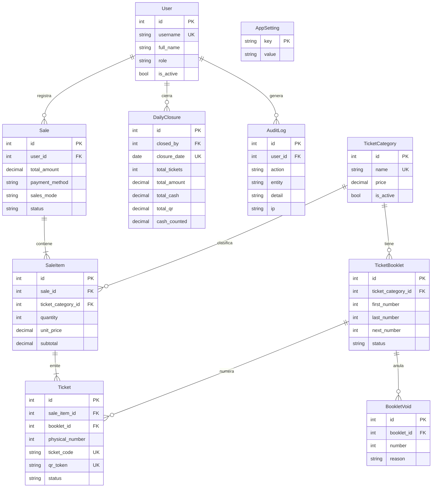

# Sistema de Entradas — Museo de Historia Natural

Aplicación web para vender entradas, controlar el ingreso y cuadrar la caja del día en un museo. Vende con tickets QR o con talonarios físicos numerados, valida el ingreso en la puerta, genera cierres diarios y reportes exportables a Excel. Corre en una computadora del museo, se usa desde cualquier dispositivo de la red local y no necesita internet.


## Contenido

- [Qué hace](#qué-hace)
- [Tecnologías](#tecnologías)
- [Instalación](#instalación)
- [Uso diario](#uso-diario)
- [Comandos](#comandos)
- [Variables de entorno](#variables-de-entorno)
- [Usuarios y roles](#usuarios-y-roles)
- [Estructura del proyecto](#estructura-del-proyecto)
- [Modelo de datos](#modelo-de-datos)
- [Reglas de negocio](#reglas-de-negocio)
- [Seguridad](#seguridad)
- [Pruebas](#pruebas)
- [Red local y HTTPS](#red-local-y-https)
- [Respaldos y registros](#respaldos-y-registros)
- [Problemas frecuentes](#problemas-frecuentes)
- [Pendiente](#pendiente)
- [Licencias de terceros](#licencias-de-terceros)

## Qué hace

| Módulo | Funciones |
| --- | --- |
| Ventas | Registro de ventas por categoría, con pago en efectivo o QR y resumen del total |
| Tickets QR | Un ticket imprimible con QR por entrada, con vigencia configurable |
| Talonarios | Control de talonarios físicos por categoría: siguiente número, stock y reposición sugerida |
| Validación | Control de ingreso con escáner USB o con la cámara del celular |
| Cierre diario | Cuadre de caja por categoría, con el rango de números consumidos en el día y el efectivo contado |
| Categorías | Nombres, precios y estado de cada categoría de entrada |
| Reportes | Ventas con filtros, entradas e ingresos, y exportación a CSV (se abre en Excel) |
| Usuarios | Cuentas con rol de administrador, vendedor o inspector |
| Auditoría | Registro de cambios de precio, anulaciones, talonarios, cierres, usuarios y ajustes |
| Dashboard | Resumen del día para el administrador |

### Dos formas de vender

Se cambia en **Ajustes → Modo de venta**, con un clic. Las ventas ya hechas no se tocan.

| Modo | Qué hace |
| --- | --- |
| Ticket con QR | Cada venta genera tickets imprimibles con QR, que se validan en la puerta |
| Talonario físico | No se imprime nada: el sistema indica qué números del talonario entregar y lleva la cuenta de cada categoría |

## Tecnologías

- **Backend:** Python 3.11, Flask 3.0, Flask-SQLAlchemy, Flask-Login, Flask-WTF (CSRF)
- **Base de datos:** SQLite en modo WAL (`instance/museo.db`). Admite PostgreSQL definiendo `DATABASE_URL`
- **Servidor:** Waitress
- **QR:** qrcode y Pillow para generarlos, jsQR para leerlos con la cámara
- **Interfaz:** plantillas Jinja2, Bootstrap 5 y Bootstrap Icons. Todo (CSS, JavaScript y fuentes) está incluido en el repositorio: no carga nada de internet. Modo claro y oscuro, adaptada a laptop y celular, con impresión para térmica de 80 mm
- **HTTPS opcional:** Caddy como proxy local
- **Pruebas:** pytest

## Instalación

Requisitos: **Windows** y **Python 3.11 o superior**. Los scripts `.bat` esperan que el entorno virtual esté en una carpeta llamada `venv` dentro del proyecto.

```bat
:: 1. Descarga el proyecto
git clone https://github.com/Erickxdps/mhn-ticketing.git
cd mhn-ticketing

:: 2. Crea y activa el entorno virtual
python -m venv venv
venv\Scripts\activate

:: 3. Instala las dependencias
pip install -r requirements.txt

:: 4. Crea la base de datos (tablas, ajustes y categorías iniciales)
flask --app run.py upgrade-db

:: 5. Crea el primer administrador (pregunta usuario, nombre y contraseña)
flask --app run.py create-admin
```

La base de datos nace con cinco categorías, que luego se pueden editar en **Categorías**:

| Categoría | Precio inicial (Bs) |
| --- | --- |
| Mayores | 5.00 |
| Menores | 3.00 |
| Extranjeros | 12.00 |
| Tercera edad | 2.00 |
| Cortesía | 2.00 |

No hace falta ningún archivo de configuración: la clave secreta se genera sola y se usa SQLite.

## Uso diario

Inicia el sistema con **`iniciar_servidor.bat`** (doble clic). Arranca minimizado, con la ventana negra en la barra de tareas, y abre solo el navegador en <http://localhost:8472>. Cerrar esa ventana apaga el sistema, así que no la cierres mientras atiendes público.

Ejecuta una sola vez `crear_acceso_directo.bat` para tener en el Escritorio los accesos con el icono del museo:

- **Sistema de Entradas MHN:** equivale a `iniciar_servidor.bat`.
- **Sistema de Entradas MHN (HTTPS):** equivale a `iniciar_https.bat`, para usar la cámara del celular.

Usa solo uno a la vez.

### Arranque rápido

La base de datos se revisa solo cuando cambió el sistema (primera vez o tras actualizar archivos); el resto de las veces arranca directo. La revisión guarda antes un respaldo `pre_actualizacion_*.db` en `instance\backups`, se puede repetir sin riesgo y conserva todas las ventas. También puede ejecutarse a mano con `actualizar_bd.bat`.

### Actualizar un sistema en uso

1. Apaga el sistema (cierra la ventana negra o pulsa `Ctrl+C`).
2. Copia los archivos nuevos sobre la carpeta del proyecto. **No borres ni reemplaces `instance\` ni `venv\`.**
3. Vuelve a abrir con `iniciar_servidor.bat`.

## Comandos

Con el entorno virtual activado:

| Comando | Qué hace |
| --- | --- |
| `flask --app run.py upgrade-db` | Crea o actualiza la base de datos. Con datos previos, guarda antes un respaldo |
| `flask --app run.py create-admin` | Crea un usuario administrador |
| `flask --app run.py reset-password` | Restablece la contraseña de un usuario y lo reactiva (por si el único administrador la olvidó) |
| `python backup_db.py` | Crea un respaldo verificado de la base de datos |
| `python run.py` | Inicia el servidor de desarrollo de Flask en el puerto 8472 |

Scripts de Windows (doble clic):

| Script | Qué hace |
| --- | --- |
| `iniciar_servidor.bat` | Inicia el sistema por HTTP en el puerto 8472 y abre el navegador |
| `iniciar_https.bat` | Inicia el sistema por HTTPS con Caddy (puerto 443) |
| `crear_acceso_directo.bat` | Crea los accesos directos en el Escritorio |
| `actualizar_bd.bat` | Ejecuta `upgrade-db` |
| `respaldar_bd.bat` | Ejecuta `backup_db.py` |
| `programar_respaldo.bat` | Programa un respaldo diario a las 18:30 en el Programador de tareas |

`_abrir_navegador.bat` es un auxiliar que usan los scripts de inicio; no se ejecuta a mano.

## Variables de entorno

Todas son opcionales. Para cambiar alguna, copia `.env.example` como `.env` y edítalo.

| Variable | Por defecto | Para qué sirve |
| --- | --- | --- |
| `SECRET_KEY` | Se genera sola | Firma las sesiones. Si falta, es corta o es una clave de ejemplo, se usa una aleatoria guardada en `instance/secret.key` |
| `DATABASE_URL` | `instance/museo.db` | Conexión a otra base de datos (por ejemplo PostgreSQL) |
| `BEHIND_PROXY` | `0` | Ponla en `1` si hay un proxy (Caddy) delante. `iniciar_https.bat` ya la define |
| `COOKIE_SECURE` | `0` | Ponla en `1` si todo el acceso es por HTTPS. `iniciar_https.bat` ya la define |
| `BACKUP_EXTRA_DIR` | — | Segunda copia de cada respaldo, en otro disco o carpeta sincronizada |
| `PRECIO_MAXIMO` | `9999.99` | Precio máximo permitido por categoría |
| `MAX_TICKETS_POR_VENTA` | `300` | Máximo de entradas en una sola venta |
| `LOGIN_MAX_INTENTOS` | `5` | Intentos fallidos de inicio de sesión antes del bloqueo |
| `LOGIN_VENTANA_SEG` | `900` | Ventana, en segundos, en la que se cuentan los intentos fallidos |
| `LOGIN_BLOQUEO_SEG` | `900` | Duración del bloqueo, en segundos |
| `FLASK_DEBUG` | `0` | Solo para desarrollo con `python run.py`. No la definas en el equipo real |

## Usuarios y roles

| Rol | Puede |
| --- | --- |
| `ADMIN` | Todo: ventas, validación, dashboard, reportes, cierres, categorías, talonarios, usuarios, ajustes y auditoría |
| `SELLER` (vendedor) | Registrar ventas, ver solo sus propias ventas, consultar los talonarios y anular números dañados |
| `INSPECTOR` | Validar entradas en la puerta |

Cualquier usuario puede cambiar su propia contraseña. Un usuario desactivado pierde el acceso de inmediato, aunque tenga la sesión abierta.

## Estructura del proyecto

```
mhn-ticketing/
├── app/
│   ├── __init__.py         Fábrica de la aplicación, clave secreta, logs y errores
│   ├── models/             Entidades y reglas de datos
│   ├── routes/             Rutas (un blueprint por módulo)
│   ├── services/           Lógica de negocio: ventas, talonarios, ingresos, cierres, reportes
│   ├── templates/          Plantillas Jinja2
│   ├── static/             CSS, JavaScript, fuentes e iconos locales
│   ├── utils/              Decorador de roles, fechas y manejo de dinero
│   ├── security.py         Política de contraseñas y bloqueo por intentos fallidos
│   ├── cli.py              Comandos: upgrade-db, create-admin, reset-password
│   └── db_upgrade.py       Actualización idempotente de la base de datos
├── tests/                  Pruebas automatizadas
├── instance/               Datos locales: base, clave, logs y respaldos (no se sube a Git)
├── run.py                  Punto de entrada
├── config.py               Configuración
├── backup_db.py            Respaldo verificado de la base de datos
├── seed.py                 Equivalente a upgrade-db, para ejecutar con python
├── Caddyfile               Proxy HTTPS opcional
├── .env.example            Plantilla de variables de entorno
├── requirements.txt        Dependencias
├── requirements-dev.txt    Dependencias para pruebas
└── *.bat                   Inicio, HTTPS, respaldos, actualización y acceso directo
```

Las rutas reciben las peticiones, los servicios contienen la lógica de negocio y los modelos guardan los datos.

## Modelo de datos



## Reglas de negocio

**Talonarios.** Cada categoría tiene su propio talonario, con un rango de números (por ejemplo, `00249` al `00500`). El primer número registrado es el primer boleto que se va a entregar. Si una venta cruza dos talonarios, el sistema indica los dos tramos.

**Asignación de números.** Al vender, el sistema asigna los siguientes números en orden (9 Mayores desde el 00249 dan `00249 – 00257`). La asignación es atómica, así que dos vendedores nunca reciben el mismo número.

**Avisos de stock.** Cuando quedan pocos boletos (por defecto 20, configurable en Ajustes) o no hay talonario, aparece una alerta con la **reposición sugerida**, continuando desde el último número registrado. Un administrador puede registrarla sin interrumpir las ventas.

**Boletos anulados.**

| Caso | Qué pasa |
| --- | --- |
| Boleto dañado o saltado | Se registra como anulado, no se vuelve a entregar y no suma a la caja |
| Venta anulada (solo ADMIN) | Sus números quedan anulados y nunca se reutilizan |

Una venta nunca se borra: se anula, con motivo y responsable.

**Ingreso.** Un boleto de talonario se cuenta como ingresado al venderse. Un ticket QR se valida en la puerta y solo sirve una vez.

**Vigencia.** Los tickets QR vencen según *Días de vigencia* (por defecto 1, solo el día de la venta; 0 = no vencen).

**Precios.** Los cambios de nombre o precio de una categoría se aplican a las ventas nuevas. Las ventas ya registradas conservan su precio histórico y el cambio queda en la auditoría.

**Cierre diario.** Muestra, por categoría, cantidad, importe y rango de números consumidos, con el desglose entre efectivo y QR y la diferencia contra el efectivo contado. Solo hay un cierre por día. Un día cerrado no admite ventas ni anulaciones. Un ADMIN puede reabrirlo y queda en la auditoría.

## Seguridad

- Todas las pantallas exigen iniciar sesión, y los permisos se comprueban en el servidor en cada ruta.
- Todos los formularios y la validación por AJAX llevan token CSRF.
- Contraseñas de mínimo 8 caracteres, que no pueden ser solo números, claves comunes ni iguales al usuario.
- Tras 5 intentos fallidos, esa combinación de usuario y dispositivo se bloquea 15 minutos. Hay un segundo límite por dispositivo para quien prueba muchos usuarios.
- La `SECRET_KEY` se genera sola. Las cookies de sesión son `HttpOnly` y `SameSite=Lax`, y `Secure` con HTTPS.
- La reserva de números de talonario es atómica y evita duplicados.
- La auditoría registra quién hizo cada cambio sensible, con la IP. Solo se agrega: no se edita ni se borra desde la aplicación.
- Pensado para uso en red local. **No expongas el puerto a internet.**

## Pruebas

```bat
pip install -r requirements-dev.txt
python -m pytest
```

Son 60 pruebas. Usan una base temporal con datos ficticios y nunca tocan `instance/museo.db`.

| Archivo | Qué comprueba |
| --- | --- |
| `tests/test_talonarios.py` | Reserva atómica de números, cruce entre talonarios, avisos de stock, reposición y anulados |
| `tests/test_seguridad.py` | Rutas protegidas, CSRF, bloqueo de intentos y política de contraseñas |
| `tests/test_permisos_y_paginas.py` | Permisos por rol y que todas las páginas cargan |
| `tests/test_ingresos_cierres_reportes.py` | Validación de ingreso, cierres diarios y reportes |
| `tests/test_actualizacion.py` | Actualización de la base de datos desde una versión anterior y respaldo previo |

## Red local y HTTPS

El sistema funciona en la misma red Wi-Fi o por cable. Los datos móviles no sirven.

### Acceder desde otros dispositivos

1. Permite el puerto en el firewall de Windows, una sola vez (PowerShell como administrador):

   ```
   netsh advfirewall firewall add rule name="MHN Entradas" dir=in action=allow protocol=TCP localport=8472
   ```

2. Averigua la IP con `ipconfig`. Usa la **Dirección IPv4 del adaptador Wi-Fi o Ethernet**, no la de adaptadores virtuales (VirtualBox, WSL, Docker, VPN).
3. Desde el otro dispositivo abre `http://IP-de-la-computadora:8472`.

Pide que el router reserve siempre la misma IP a esa computadora. Los nombres tipo `equipo.local` fallan en muchos Android, así que usa la IP.

### HTTPS para usar la cámara del celular

Los navegadores móviles solo permiten la cámara en páginas **HTTPS**. Se logra con [Caddy](https://caddyserver.com/), que no viene en el repositorio.

**Preparación (una sola vez):**

1. Descarga Caddy para Windows (`Windows amd64`) desde <https://caddyserver.com/download> y copia `caddy.exe` a la carpeta del proyecto.
2. Permite el puerto 443:

   ```
   netsh advfirewall firewall add rule name="MHN HTTPS" dir=in action=allow protocol=TCP localport=443
   ```

**Uso diario:** abre `iniciar_https.bat` en lugar de `iniciar_servidor.bat`. No uses los dos a la vez. Desde el celular entra a `https://IP-de-la-computadora`, sin puerto. Para apagar, cierra las dos ventanas de la barra de tareas (Caddy y Flask).

**Certificado.** Caddy genera uno propio y el navegador avisa "no es seguro" la primera vez: elige *Avanzado → Continuar*. Si la cámara no se activa, copia `%APPDATA%\Caddy\pki\authorities\local\root.crt` al celular e instálalo en *Ajustes → Seguridad → Cifrado y credenciales → Instalar un certificado → Certificado de CA*.

## Respaldos y registros

- `respaldar_bd.bat` crea una copia verificada en `instance\backups` (se conservan 60 días).
- `programar_respaldo.bat` programa un respaldo diario a las 18:30.
- Con `BACKUP_EXTRA_DIR` se guarda una segunda copia en otro disco o carpeta.
- La base usa modo WAL: **no copies `museo.db` a mano con el sistema en marcha**. Usa el script.
- El respaldo solo cubre SQLite. Con PostgreSQL usa `pg_dump`.
- Los inicios de sesión, accesos denegados y errores se guardan en `instance\logs\museo.log` (rotativo, hasta 5 archivos de 1 MB).

Toda la carpeta `instance\` (base de datos, clave secreta, logs y respaldos) queda fuera de Git: cada instalación tiene la suya.

## Problemas frecuentes

| Mensaje o síntoma | Qué revisar |
| --- | --- |
| "No se encontró el entorno virtual en la carpeta venv" | Falta crear el entorno virtual. Sigue los pasos de [Instalación](#instalación) |
| "El sistema no pudo iniciar" | El puerto 8472 ya está en uso (¿el sistema ya está abierto?) o faltan dependencias |
| "Falta caddy.exe" | Descárgalo como se indica en [HTTPS](#https-para-usar-la-cámara-del-celular) |
| "Caddy no pudo iniciar" | El puerto 443 está en uso por otro programa |
| Otro dispositivo no puede entrar | Regla del firewall, IP correcta y que ambos estén en la misma red |
| La cámara del celular no abre | Entra por `https://`, no por `http://`, e instala el certificado de Caddy |
| El administrador olvidó su contraseña | `flask --app run.py reset-password` |

## Pendiente

- Instalación en la computadora del museo y prueba de una jornada completa de ventas y cierre.
- Reserva de IP fija en el router del museo.
- Instalar el certificado de Caddy en los celulares que escaneen entradas.
- Script de migración de SQLite a PostgreSQL, si algún día se necesita.

## Licencias de terceros

El repositorio incluye copias locales de Bootstrap 5.3.3 (MIT), Bootstrap Icons 1.11.3 (MIT), jsQR 1.4.0 (Apache-2.0) y las fuentes Source Serif 4, Public Sans e IBM Plex Mono (SIL OFL 1.1). El detalle está en `app/static/vendor/LICENSES.txt`.
