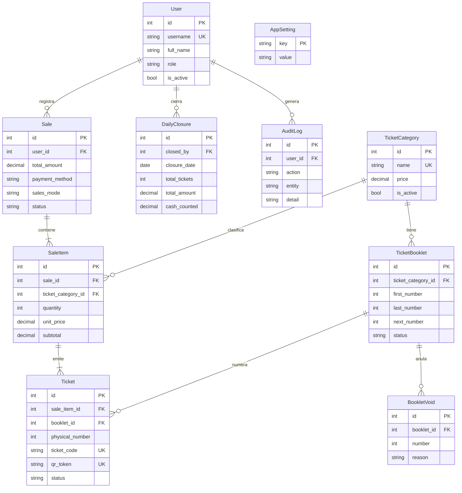

# Sistema de Entradas — Museo de Historia Natural

Aplicación web para vender entradas, controlar el ingreso y cuadrar la caja del día en un museo. Vende con tickets QR o con talonarios físicos numerados, valida el ingreso desde la puerta, genera cierres diarios y reportes exportables a Excel. Funciona en la red local y no necesita internet.


## Contenido

- [Qué hace](#qué-hace)
- [Tecnologías](#tecnologías)
- [Puesta en marcha](#puesta-en-marcha)
- [Variables de entorno](#variables-de-entorno)
- [Usuarios y roles](#usuarios-y-roles)
- [Estructura del proyecto](#estructura-del-proyecto)
- [Modelo de datos](#modelo-de-datos)
- [Reglas de negocio](#reglas-de-negocio)
- [Seguridad](#seguridad)
- [Pruebas](#pruebas)
- [Red local y HTTPS](#red-local-y-https)
- [Respaldos](#respaldos)
- [Estado del proyecto](#estado-del-proyecto)

## Qué hace

| Módulo | Funciones |
| --- | --- |
| Ventas | Registro de ventas por categoría, con pago en efectivo o QR y resumen del total |
| Tickets QR | Un ticket imprimible con QR por boleto, con vigencia configurable |
| Talonarios | Control de talonarios físicos por categoría: siguiente número, stock y reposición sugerida |
| Validación | Control de ingreso con escáner USB o cámara del celular |
| Cierre diario | Cuadre de caja por categoría, con el rango de números consumidos en el día |
| Categorías | Nombres, precios y estado de cada categoría de entrada |
| Reportes | Ventas con filtros, entradas e ingresos, y exportación a CSV (se abre en Excel) |
| Usuarios | Cuentas con rol de administrador, vendedor o inspector |
| Auditoría | Registro de cambios de precio, anulaciones, talonarios, cierres, usuarios y ajustes |

### Dos formas de vender

Se cambia en **Ajustes → Modo de venta**, con un clic. Las ventas ya hechas no se tocan.

| Modo | Qué hace |
| --- | --- |
| Ticket con QR | Cada venta genera tickets imprimibles con QR, que se validan en la puerta |
| Talonario físico | No se imprime nada: el sistema indica qué números del talonario entregar y lleva la cuenta de cada categoría |

## Tecnologías

- **Backend:** Python 3.11, Flask 3.0, Flask-SQLAlchemy, Flask-Login, Flask-WTF (CSRF), Flask-Migrate
- **Base de datos:** SQLite en modo WAL (`instance/museo.db`). Lista para PostgreSQL con solo definir `DATABASE_URL`
- **Servidor:** Waitress
- **QR:** qrcode y Pillow
- **Interfaz:** plantillas Jinja2, Bootstrap 5 e iconos locales, HTML, CSS y JavaScript sin dependencias externas. Modo claro y oscuro, adaptada a laptop y celular, con impresión para térmica de 80 mm
- **Escáner de cámara:** jsQR
- **HTTPS opcional:** Caddy
- **Pruebas:** pytest

## Puesta en marcha

Necesitas Python 3.11 o superior y Windows.

```bash
# 1. Entra en la carpeta del proyecto y crea el entorno virtual
python -m venv venv
venv\Scripts\activate

# 2. Instala las dependencias
pip install -r requirements.txt

# 3. Crea o actualiza la base de datos
flask --app run.py upgrade-db

# 4. Crea el primer administrador
flask --app run.py create-admin
```

Después inicia el sistema con **`iniciar_servidor.bat`** (doble clic). Arranca minimizado, con la ventana negra en la barra de tareas, y abre solo el navegador en <http://localhost:8472>. No cierres esa ventana mientras atiendes público: apaga el sistema.

Ejecuta una sola vez `crear_acceso_directo.bat` para tener en el Escritorio los accesos con el icono del museo:

- **Sistema de Entradas MHN:** equivale a `iniciar_servidor.bat`.
- **Sistema de Entradas MHN (HTTPS):** equivale a `iniciar_https.bat`, para usar la cámara del celular.

Usa solo uno a la vez.

### Arranque rápido

La base de datos se revisa solo cuando cambió el sistema (primera vez o tras actualizar archivos). El resto de las veces arranca directo. La revisión guarda antes un respaldo `pre_actualizacion_*.db` en `instance\backups`, es segura de repetir y conserva todas las ventas. También puede ejecutarse a mano con `actualizar_bd.bat`.

### Actualizar un sistema en uso

1. Apaga el sistema (cierra la ventana negra o pulsa `Ctrl+C`).
2. Copia los archivos nuevos sobre la carpeta del proyecto. No borres ni reemplaces `instance\` ni `venv\`.
3. Vuelve a abrir con `iniciar_servidor.bat`.

## Variables de entorno

| Variable | Obligatoria | Para qué sirve |
| --- | --- | --- |
| `SECRET_KEY` | No | Firma las sesiones. Si falta, se genera sola en `instance/secret.key` |
| `DATABASE_URL` | No | Conexión a otra base de datos. Si falta, se usa `instance/museo.db` |
| `BEHIND_PROXY` | No | Ponla en `1` si hay un proxy (Caddy) delante. `iniciar_https.bat` ya la define |
| `COOKIE_SECURE` | No | Ponla en `1` si todo el acceso es por HTTPS. `iniciar_https.bat` ya la define |
| `BACKUP_EXTRA_DIR` | No | Segunda copia de cada respaldo, en otro disco o carpeta sincronizada |
| `PRECIO_MAXIMO` | No | Precio máximo permitido por categoría (por defecto `9999.99`) |
| `FLASK_DEBUG` | No | Solo para desarrollo. Déjala sin definir en el equipo real |

No hace falta definir ninguna para empezar: se usa SQLite y una clave generada automáticamente. Copia `.env.example` como `.env` si quieres cambiar algo.

## Usuarios y roles

| Rol | Puede |
| --- | --- |
| `ADMIN` | Todo: dashboard, reportes, cierres, categorías, talonarios, usuarios, ajustes y auditoría |
| `SELLER` (vendedor) | Registrar ventas, ver sus propias ventas y anular números dañados |
| `INSPECTOR` | Validar entradas QR |

## Estructura del proyecto

```
museo_entradas/
├── app/
│   ├── models/             Entidades y reglas de datos
│   ├── routes/             Rutas (un blueprint por módulo)
│   ├── services/           Lógica de negocio: ventas, talonarios, cierres, reportes
│   ├── templates/          Plantillas Jinja2
│   ├── static/             CSS, JavaScript, fuentes e iconos locales
│   ├── utils/              Decoradores, fechas y manejo de dinero
│   ├── cli.py              Comandos: upgrade-db, create-admin, reset-password
│   └── db_upgrade.py       Actualización idempotente de la base de datos
├── tests/                  Pruebas automatizadas
├── instance/               Datos locales: base, respaldos y clave (no se sube a Git)
├── run.py                  Punto de entrada
├── config.py               Configuración
├── Caddyfile               Proxy HTTPS opcional
├── requirements.txt        Dependencias
├── requirements-dev.txt    Dependencias para pruebas
└── *.bat                   Inicio, HTTPS, respaldos, actualización y acceso directo
```

Las rutas reciben las peticiones, los servicios contienen la lógica de negocio y los modelos guardan los datos.

## Modelo de datos



## Reglas de negocio

**Talonarios.** Cada categoría tiene su propio talonario, con un rango de números (por ejemplo, `00249` al `00500`). El primer número registrado es el primer boleto que se va a entregar. Si una venta cruza dos talonarios, el sistema indica los dos tramos.

**Asignación de números.** Al vender, el sistema asigna los siguientes números en orden (9 Mayores desde el 00249 dan `00249 – 00257`). La asignación es atómica, así que dos vendedores nunca reciben el mismo número.

**Avisos de stock.** Cuando quedan pocos boletos (por defecto 20, configurable) o no hay talonario, aparece una alerta con la **reposición sugerida**, continuando desde el último número registrado. Un administrador puede registrarla sin interrumpir las ventas.

**Boletos anulados.**

| Caso | Qué pasa |
| --- | --- |
| Boleto dañado o saltado | Se registra como anulado, no se vuelve a entregar y no suma a la caja |
| Venta anulada (solo ADMIN) | Sus números quedan anulados y nunca se reutilizan |

**Ingreso.** Un boleto de talonario se cuenta como ingresado al venderse. Un ticket QR se valida en la puerta y solo sirve una vez.

**Vigencia.** Los tickets QR vencen según *Días de vigencia* (por defecto 1, solo el día de la venta; 0 = no vencen).

**Precios.** Los cambios de nombre o precio de una categoría se aplican a las ventas nuevas. Las ventas ya registradas conservan su precio histórico y el cambio queda en la auditoría.

**Cierre diario.** Muestra, por categoría, cantidad, importe y rango de números consumidos. Un día cerrado no admite ventas ni anulaciones. Un ADMIN puede reabrirlo y queda en la auditoría.

## Seguridad

- Todas las pantallas exigen iniciar sesión, y los permisos se comprueban en el servidor en cada ruta.
- Todos los formularios y la validación por AJAX llevan token CSRF.
- Contraseñas de mínimo 8 caracteres, sin claves comunes ni iguales al usuario. Tras 5 intentos fallidos, la cuenta se bloquea 15 minutos.
- La `SECRET_KEY` se genera sola y las cookies de sesión son `HttpOnly`, y `Secure` con HTTPS.
- La reserva de números de talonario es atómica y evita duplicados.
- La auditoría registra quién hizo cada cambio sensible, con la IP.
- Pensado para uso en red local. No expongas el puerto a internet.

## Pruebas

```bash
pip install -r requirements-dev.txt
python -m pytest
```

Las pruebas usan una base temporal con datos ficticios y nunca tocan `instance/museo.db`.

| Archivo | Qué comprueba |
| --- | --- |
| `tests/test_talonarios.py` | Reserva atómica de números, cruce entre talonarios, avisos de stock, reposición y anulados |
| `tests/test_seguridad.py` | Rutas protegidas, CSRF, bloqueo de intentos y política de contraseñas |
| `tests/test_permisos_y_paginas.py` | Permisos por rol y que todas las páginas cargan |
| `tests/test_ingresos_cierres_reportes.py` | Validación de ingreso, cierres diarios y reportes |
| `tests/test_actualizacion.py` | Actualización de la base de datos desde una versión anterior y respaldo previo |

## Red local y HTTPS

El sistema funciona en la misma red Wi-Fi o por cable. Los datos móviles no sirven.

### Acceder desde otros dispositivos

1. Permite el puerto en el firewall de Windows, una sola vez (PowerShell como administrador):

   ```
   netsh advfirewall firewall add rule name="MHN Entradas" dir=in action=allow protocol=TCP localport=8472
   ```

2. Averigua la IP con `ipconfig`. Usa la **Dirección IPv4 del adaptador Wi-Fi o Ethernet**, no la de adaptadores virtuales (VirtualBox, WSL, Docker, VPN).
3. Desde el otro dispositivo abre `http://IP-de-la-computadora:8472`.

Pide que el router reserve siempre la misma IP a esa computadora. Los nombres tipo `equipo.local` fallan en muchos Android, así que usa la IP.

### HTTPS para usar la cámara del celular

Los navegadores móviles solo permiten la cámara en páginas **HTTPS**. Se logra con [Caddy](https://caddyserver.com/).

**Preparación (una sola vez):**

1. Descarga Caddy para Windows (`Windows amd64`) y copia `caddy.exe` a la carpeta del sistema.
2. Permite el puerto 443:

   ```
   netsh advfirewall firewall add rule name="MHN HTTPS" dir=in action=allow protocol=TCP localport=443
   ```

**Uso diario:** abre `iniciar_https.bat` en lugar de `iniciar_servidor.bat`. No uses los dos a la vez. Desde el celular entra a `https://IP-de-la-computadora`, sin puerto. Para apagar, cierra las dos ventanas de la barra de tareas (Caddy y Flask).

**Certificado.** Caddy genera uno propio y el navegador avisa "no es seguro" la primera vez: elige *Avanzado → Continuar*. Si la cámara no se activa, copia `%APPDATA%\Caddy\pki\authorities\local\root.crt` al celular e instálalo en *Ajustes → Seguridad → Cifrado y credenciales → Instalar un certificado → Certificado de CA*.

## Respaldos

- `respaldar_bd.bat` crea una copia verificada en `instance\backups` (se conservan 60 días).
- `programar_respaldo.bat` programa un respaldo diario a las 18:30.
- Con `BACKUP_EXTRA_DIR` se guarda una segunda copia en otro disco o carpeta.
- La base usa modo WAL: **no copies `museo.db` a mano con el sistema en marcha**. Usa el script.

## Estado del proyecto

El sistema pasó una auditoría de deficiencias, se amplió con el modo de talonario físico y se rediseñó el front-end.

**Hecho y probado**

- **Ventas:** modo QR y modo talonario físico, con cambio por ajuste global.
- **Talonarios:** números por categoría, avisos de stock, reposición sugerida y registro de boletos anulados.
- **Seguridad:** rutas protegidas, permisos por rol, CSRF, bloqueo de intentos y auditoría.
- **Interfaz:** rediseño institucional verde, modo claro y oscuro, adaptada a laptop y celular, con impresión para térmica de 80 mm.
- **Operación:** arranque rápido y minimizado, apertura automática del navegador, acceso directo con icono, respaldos programados y HTTPS opcional para la cámara.
- **Pruebas:** 60 pruebas automáticas pasan.

**Pendiente**

- Instalación en la computadora del museo y prueba de una jornada completa de ventas y cierre.
- Reserva de IP fija en el router del museo.
- Instalar el certificado de Caddy en los celulares que escaneen entradas.
- Script de migración de SQLite a PostgreSQL, si algún día se necesita.
